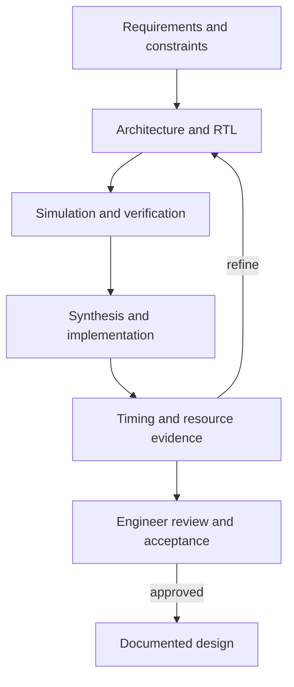
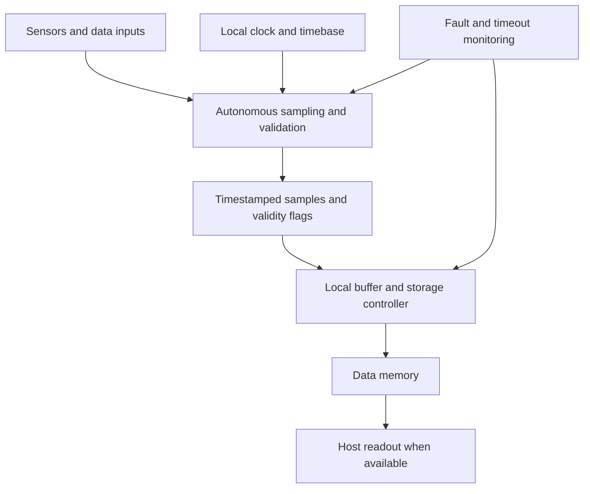
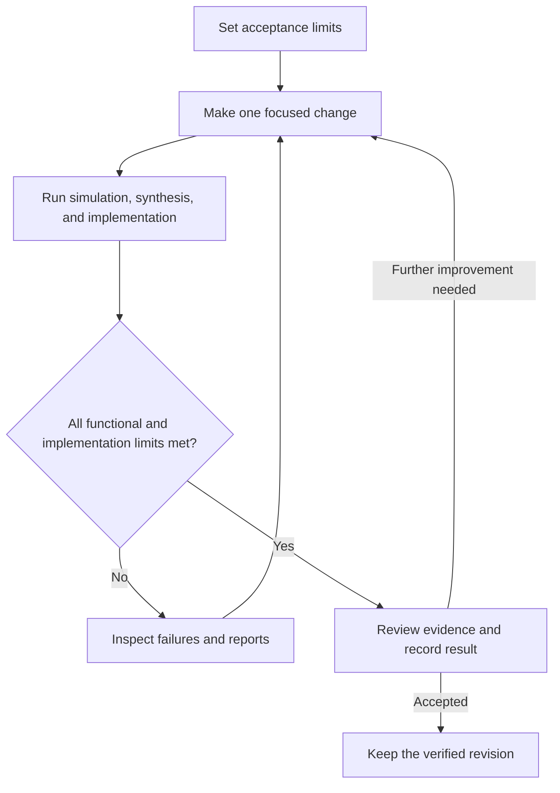

# How AI Agents Partner with FPGA Designers

## A collaborative workflow from architecture to constraint-driven iteration

FPGA development combines architectural judgment with detailed verification and implementation analysis. Designers must balance functionality, latency, throughput, timing, resource use, and power within the limits of a physical device. AI agents can support this process by helping translate requirements into design options, preparing RTL and testbenches, executing established tool flows, and analysing the resulting evidence.

An effective partnership gives the designer responsibility for engineering decisions and gives the agent a defined role in carrying out and evaluating the work. The designer establishes the requirements, selects the architecture, and reviews significant changes. Within that scope, the agent can perform successive development tasks, investigate failures, and propose refinements based on simulation and implementation results.

The quality of this collaboration depends on the information and feedback available to both participants. Clear interface contracts, measurable acceptance criteria, reliable tool outputs, and reviewable revisions allow the designer to assess the agent’s contributions throughout the development cycle.

### The agent-assisted design loop

The workflow connects design decisions with measured results. The agent supports the transitions between stages, while the designer evaluates whether the evidence justifies the next step.

## 1. Start with requirements and measurable constraints

Collaboration begins with a design brief that defines the FPGA’s inputs, outputs, and operating conditions. The designer establishes the system requirements, and the agent can organise them into specifications and verification tasks. Useful requirements include:

- input and output interfaces, widths, protocols, and clock domains;
- sample or transaction rates, maximum latency, and buffering requirements;
- target FPGA family and available logic, memory, DSP, and I/O resources;
- clock frequencies, timing margins, reset behaviour, and permitted operating modes;
- response to overflow, malformed input, missing data, or asynchronous events;
- verification evidence required for each requirement.

This exchange can expose ambiguity before it reaches the RTL. Consider a real-time data acquisition system required to continue operating as surrounding systems begin to fail. The host processor may stall, communications may disappear, and individual data sources may become unreliable. The design brief must specify which channels must continue sampling, the permitted timing error, how missing or invalid samples are identified, and how long data must be retained without host access. The agent can organise these failure scenarios into explicit requirements; the designer determines the required operating envelope and acceptance criteria.

Continued operation depends on a defined boundary of independence. The acquisition subsystem needs an available power supply, a dependable local clock, and reset behaviour that prevents a host restart from unnecessarily stopping acquisition. If loss of main power is within scope, the designer must specify backup or hold-up energy and the required operating duration. These requirements turn a broad resilience objective into behaviour that can be implemented and verified.

## 2. Explore architecture before committing to RTL

During architecture exploration, the designer and agent can examine several ways to satisfy the same requirement. For the resilient data acquisition system, the central question is how sampling, timestamping, and local storage can continue without host software or a working communications link. Candidate architectures might combine autonomous sampling logic, a local timebase, per-channel validity checks, and block RAM buffering with an independent path to external storage. A demanding datapath might also benefit from pipelining, parallel processing lanes, time-multiplexing, or dedicated DSP blocks.

The agent can compare buffer capacity, storage bandwidth, and the duration of operation without readout. The designer establishes what happens when a sensor stops responding, synchronisation is lost, or storage fills. Possible policies include marking gaps, continuing unaffected channels, retaining the newest samples, or preserving a defined fault interval. The selected policy must make data loss and degraded timing visible in the recorded data.

The agent can calculate preliminary data rates and storage requirements, outline module boundaries, and document the trade-offs between alternatives. The designer assesses these proposals in the context of device capabilities, interface behaviour, and integration requirements. Decisions about clock ownership, backpressure, reset handling, and handshake stability remain explicit parts of the architecture.

Early estimates guide exploration but require confirmation. Coding style, synthesis settings, and the target device influence the hardware that tools infer. The designer therefore treats each candidate as a proposal to be evaluated through implementation.

## 3. Refine the design into implementable blocks

Once an architecture is selected, the collaboration moves to module definitions. Each block needs a clear responsibility and an agreed interface. The real-time data acquisition system may include autonomous sampling, input validation, local timestamping, buffering, storage control, and fault monitoring. Host configuration and readout form a separate service path whose loss must not block acquisition. The diagram below illustrates one possible arrangement, assuming the acquisition subsystem retains power and a valid local clock.

Module contracts define how faults are contained. A timeout on one input should not indefinitely block other channels; a stalled readout request should not halt the storage path; and loss of external time synchronisation should produce a defined local timing mode with an explicit status flag. The designer decides which failures the system must tolerate, while the agent helps express those decisions as state transitions, interface rules, and verification checks.

The designer establishes the intended behaviour, while the agent can help develop interface contracts, state-machine descriptions, register maps, reset sequences, and timing assumptions. Review can then focus on specific risks, including unintended latches, multiple drivers, unsynchronised control signals, ambiguous reset behaviour, counter boundaries, and width or signedness mismatches.

Keeping these contracts alongside the RTL gives both parties a common reference. Project conventions, language versions, naming rules, and existing modules provide further guidance. Small revisions make it easier to identify what changed and determine whether the result still meets the agreed behaviour.

## 4. Generate RTL with the implementation in mind

With a sufficiently detailed module contract, an agent can draft Verilog or VHDL, propose parameterisation, explain unfamiliar code, or refactor repeated logic. The designer improves the usefulness of these contributions by specifying interface widths, clock and reset polarity, handshake rules, expected latency, and prohibited constructs.

Review then concentrates on the hardware represented by the RTL: cycle-by-cycle behaviour, inferred registers and memories, reset semantics, and toolchain compatibility. Assumptions and unverified details should accompany the proposed implementation so that the designer can resolve them before integration.

## 5. Build verification alongside the design

Verification develops alongside the implementation. The designer defines the expected behaviour and important failure conditions; the agent can translate these into testbench scaffolding, directed tests, assertions, and constrained-random stimulus. Relevant cases include simultaneous events, buffer wraparound, backpressure, reset during activity, maximum counts, invalid commands, and clock-domain interactions.

For the data acquisition example, verification includes deliberate fault injection: halting the host, interrupting communications, withholding sensor responses, removing external synchronisation, and restarting the host while acquisition remains active. The tests check that unaffected channels maintain their required sample cadence, timestamps follow the specified degraded-mode behaviour, and invalid or missing data is clearly marked. Combined failures and storage exhaustion also need defined outcomes. Board-level tests then assess physical assumptions such as reset isolation and operation during the specified power hold-up interval.

When a test fails, the agent can examine the failing transaction, assertion message, relevant RTL, and accessible waveform data. It can then propose a cause and a focused correction. Repeating the failing test and the relevant regression checks provides evidence that the correction addresses the defect without introducing another one.

The designer also reviews the verification itself. Tests generated from the same interpretation as the RTL can reproduce an incorrect assumption, so passing simulation alone is insufficient. Independent checks, assertions, formal methods where appropriate, code review, and hardware testing provide complementary evidence.

## 6. Close the loop with synthesis and timing results

After a design change, an agent with access to the project environment can run the established simulation, lint, synthesis, and implementation commands. It can summarise errors, warnings, resource utilisation, critical paths, slack, and unconstrained paths, giving the designer a concise basis for further decisions.

These reports direct the next investigation. A failing timing path may suggest an additional pipeline stage or a different partition of combinational logic. Excessive block RAM use may prompt changes to depth, width, packing, or buffering. Unexpected logic growth may reveal duplicated arithmetic or broad decode structures. Each proposed adjustment is evaluated against the same functional and implementation checks.

Progress is judged against the complete set of constraints. A timing improvement may carry a latency or area cost, while a resource reduction may affect throughput. The designer weighs these trade-offs, and the agent helps quantify them through repeatable runs and comparisons.

## 7. Revisit architecture after the first implementation pass

The first complete implementation is a particularly useful point for renewed architecture exploration. Synthesis and place-and-route reports reveal whether the initial structure fits the device and where its practical limitations lie. The agent can assemble a baseline covering logic, memory, DSP and I/O utilisation, timing slack, critical paths, latency, and unconstrained paths.

The designer can then revisit decisions that were initially based on estimates. A long combinational path may justify comparing deeper pipelining with a different datapath partition. High memory utilisation may favour alternative buffering or data packing. A throughput shortfall may require more parallelism or a revised scheduling strategy. Each candidate should identify the observed limitation, expected benefit, implementation cost, and verification implications.

In the data acquisition example, this review also examines fault containment. If a shared bus allows a stalled host to delay sample writes, the designer may separate acquisition and readout paths or introduce bounded arbitration. If fault-injection results reveal insufficient buffering during storage delays, the agent can evaluate revised buffer depths and scheduling policies. Each architectural revision must preserve the required acquisition behaviour under both normal and degraded conditions.

The agent’s role is to make those alternatives concrete and comparable. The designer selects the candidates worth implementing and identifies any system-level consequences that the reports alone cannot capture. Architecture exploration therefore continues after the first pass, informed by evidence from the actual design.

## 8. Iterate from a measured baseline

A recorded baseline makes subsequent experiments easier to interpret. Each experiment starts with a specific hypothesis, such as whether an additional pipeline stage can improve slack while keeping latency within its limit. Changing one major architectural choice at a time and retaining consistent testbenches, constraints, tool versions, and implementation settings supports meaningful comparison.

The agent can maintain a results table containing the revision, proposed change, functional outcome, resource use, timing, latency, and relevant power estimate. The designer compares these results with both the previous baseline and the acceptance limits. Additional area may be justified by a hard throughput requirement, while a faster design may still be unsuitable if it exceeds the device budget.

A candidate that passes the required checks and improves the relevant trade-off can become the next baseline. Unsuccessful experiments remain useful when their results are recorded: they reveal which assumptions were incorrect or where a bottleneck moved. The process continues until the design meets its constraints with acceptable margin and the final revision is supported by reviewable evidence.

## 9. Connect the agent to shell commands and vendor tools

Practical collaboration requires an interface between the agent and the project’s tools. A shell tool allows the agent to inspect files, invoke build and simulation scripts, and read exit codes, logs, and reports. An established flow might compile a Quartus project using `quartus_sh --flow compile project`, launch Vivado with a batch Tcl script, or invoke the project’s simulator.

Vendor command-line programs, scripting APIs such as Tcl, and project-specific wrappers can expose repeatable compilation, simulation, synthesis, implementation, and reporting operations. The designer defines the supported workflow and relevant settings. The agent executes those operations within its authorised scope and uses the outputs to guide further analysis.

| FPGA vendor and tools | Interface the agent can call | Typical agent tasks |
|---|---|---|
| Intel/Altera Quartus Prime | Shell commands such as `quartus_sh --flow compile <project>` and Tcl scripts launched with `quartus_sh -t <script.tcl>`. [Quartus scripting documentation](https://www.intel.com/content/www/us/en/support/programmable/support-resources/design-guidance/quartus-support.html) | Run compilation, inspect timing and resource reports, and compare revisions against constraints. |
| AMD Vivado | Batch Tcl with `vivado -mode batch -source <script.tcl>`. [Vivado batch Tcl guide](https://docs.amd.com/r/en-US/ug892-vivado-design-flows-overview/Launching-the-Vivado-Tools-Using-a-Batch-Tcl-Script) | Run synthesis and implementation, generate timing and utilization reports, and inspect critical paths. |
| Lattice Radiant | Tcl-based scripting and reporting through the Radiant command-line tools, including `radiantc`. [Radiant version history and scripting notes](https://www.latticesemi.com/Products/DesignSoftwareAndIP/FPGAandLDS/Radiant/RadiantVersionHistory) | Run supported synthesis and implementation steps, collect reports, and check device-specific constraints. |
| Efinix Efinity | Command-line flow using `efx_run.py <project>.xml --flow <flow>` on Linux or `efx_run.bat` on Windows. Tcl timing-report scripts can run through `--flow sta_tclsh --tcl_script <script.tcl>`. [Efinity command-line guide](https://www.efinixinc.com/docs/efinity-command-line-v1.0.pdf) | Run compile and supported RTL simulation flows, collect timing reports, and explore synthesis/place-and-route options with `efx_run_aoe.py`. [Automated Option Explorer](https://www.efinixinc.com/products-efinity.html) |
| Microchip Libero SoC | Tcl scripts run from the Windows or Linux command line or as batch scripts. [Libero SoC Tcl reference](https://ww1.microchip.com/downloads/aemDocuments/documents/FPGA/swdocs/libero/libero_soc_tcl_cmd_ref_ug_2024_2.pdf) | Replay project operations, run supported design flows, and collect timing and implementation reports. |

### Simulation tools by FPGA vendor

Simulation is often handled by a separate executable from the synthesis and implementation suite. The project’s tool setup must account for supported simulator versions, device models, and IP libraries before runs can be automated reliably.

| FPGA vendor and suite | Simulation tools available | Agent-facing simulation interface |
|---|---|---|
| Intel/Altera Quartus Prime | Questa-Altera FPGA Edition and supported QuestaSim, Aldec Active-HDL/Riviera-PRO, Cadence Xcelium, and Synopsys VCS versions. The supported list depends on Quartus edition and release. [Quartus simulator support](https://www.intel.com/programmable/technical-pdfs/683870.pdf) | Use Quartus-generated simulation scripts or NativeLink where available, then run the simulator in batch mode and collect its logs and waveforms. [Quartus simulation flows](https://www.intel.com/content/www/us/en/support/programmable/support-resources/design-guidance/quartus-support.html) |
| AMD Vivado | Vivado Simulator (`xsim`) is integrated. Supported external choices include Questa/ModelSim, Riviera-PRO/Active-HDL, Xcelium, and VCS, with version and platform restrictions. [Vivado supported simulators](https://docs.amd.com/r/2026.1/ug900-vivado-logic-simulation/Supported-Simulators) | Run the simulation through Vivado Tcl/batch or the simulator command-line flow; save the transcript, test results, and waveform database. |
| Lattice Radiant | Questa Lattice Edition, including `qrun` for scripted compilation and file management. [Radiant simulation features](https://www.latticesemi.com/Products/DesignSoftwareAndIP/FPGAandLDS/Radiant?ActiveTab=Help) | Use the generated or project-maintained Questa scripts and run them in batch; retain the simulator transcript and waveform output. |
| Efinix Efinity | Icarus Verilog (`iVerilog`) is the default in the documented command-line simulation flow. ModelSim, Aldec, and NCSim options are also available; exact support depends on the Efinity release and flow. [Efinity CLI guide](https://www.efinixinc.com/docs/efinity-command-line-v1.0.pdf) | Invoke behavioral RTL simulation with `efx_run.py <project>.xml --flow rtlsim` and post-map simulation with `--flow mapsim`; use `--modelsim` when selecting ModelSim. The Windows entry point is `efx_run.bat`. |
| Microchip Libero SoC | QuestaSim Pro ME is the default in Libero SoC v2025.2. Supported external options include ModelSim, VCS, Xcelium, Active-HDL, and Riviera-PRO, subject to the device and matching simulation libraries. [Libero simulation guide](https://ww1.microchip.com/downloads/aemDocuments/documents/FPGA/swdocs/libero/libero_custom_flow_ug_2025_2.pdf) | Run simulator batch scripts such as `run.do` or use the simulator CLI; use library builds that match the Libero and simulator versions. [Microchip simulation libraries](https://www.microchip.com/en-us/products/fpgas-and-plds/fpga-and-soc-design-tools/pre-compiled-simulation-libraries/siemens) |

The tables describe example interfaces; availability varies with tool edition, release, and device flow. Tested wrapper scripts can make these differences easier to manage by fixing settings and returning consistent exit codes, logs, and reports.

A typical collaborative iteration follows this sequence:

1. The designer defines the objective, constraints, and scope of the change.
2. The agent prepares an RTL, constraint, or testbench revision on a reviewable branch.
3. The agent runs the established build or simulation flow and collects the results.
4. The results are compared with the functional requirements and implementation limits.
5. The designer reviews the evidence and significant trade-offs, then accepts the revision or directs the next experiment.

MCP is an optional integration layer. It can standardise how project information and tool operations are exposed to an agent, but direct shell access, vendor CLIs, and scripting wrappers can also support the workflow. The essential requirement is a documented interface that enables repeatable operations and returns sufficient evidence to assess each run.

The project setup should identify supported commands, tool versions, paths, and expected outputs. Established scripts help prevent accidental differences in device settings or constraints. Review is particularly important for changes that overwrite files, alter implementation settings, or consume limited tool licences.

## 10. Make the agent’s work reproducible and reviewable

Reproducibility depends on controlled access to source files, constraints, scripts, vendor tools, and prior reports. Agent-generated changes should be associated with a branch or patch, together with a record of the commands executed and files modified. This allows the designer and other reviewers to understand and reproduce the work.

An iteration record connects the requirement being addressed with the proposed change, simulation outcome, synthesis and timing results, and unresolved assumptions. It provides continuity between experiments and makes later tool or source changes easier to investigate.

For safety-critical or regulated applications, the same engineering controls continue to apply: independent review, requirements traceability, controlled tool versions, documented verification, and qualified sign-off. Agent contributions enter that process as work requiring evaluation.

## A more connected FPGA workflow

The partnership is most useful when the agent can participate across architecture, RTL development, verification, and implementation analysis. Designers gain support for exploring alternatives and carrying out repeated tool-driven investigations, while maintaining visibility into the decisions and evidence that shape the design.

Successful collaboration depends on a clear allocation of responsibility. The FPGA designer provides system understanding, engineering judgment, and acceptance decisions. The AI agent contributes analysis, implementation assistance, and execution of repeatable workflows. Together, they can turn each iteration into a documented step towards a design that meets its requirements.
