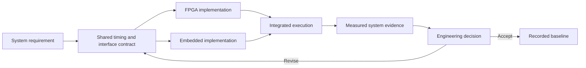
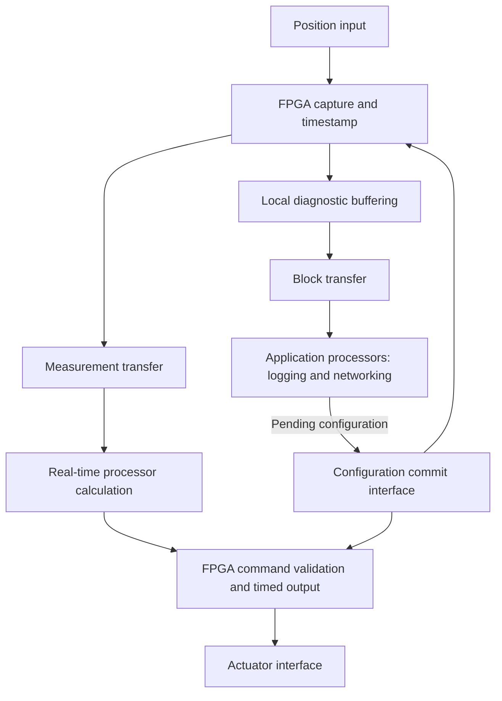
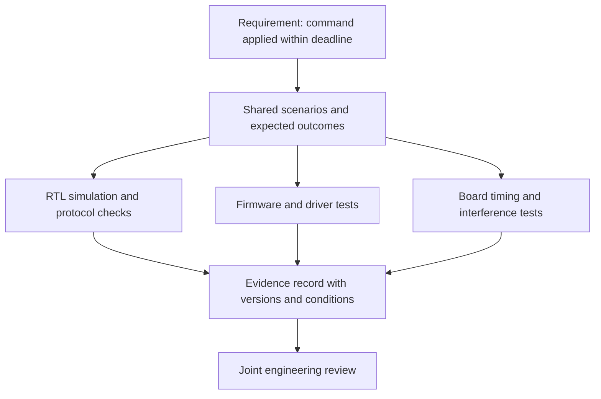

# One System, One Engineering Loop: AI Agents Across FPGA and Embedded Development

## Connecting requirements, hardware, software, and evidence

A sensor produces a sample. FPGA logic captures it, a transfer engine moves it into memory, a processor calculates a result, and an output interface applies a command. To the customer, this is one operation with one deadline. Inside the engineering team, it may cross several source trees, toolchains, test environments, and areas of responsibility.

The FPGA engineer may see a timing-clean datapath. The embedded engineer may see a driver that handles every completed transfer. Yet the product can still miss its deadline because the datapath waits for a buffer, the driver waits for a notification, or software and hardware disagree about when a command becomes active.

An AI agent can help connect these views. With access to the relevant project information and supported tools, it can follow a requirement through architecture, RTL, firmware, tests, and measured results. Its role is to maintain continuity across that work and make proposed changes concrete enough for the engineers to evaluate.

This perspective starts with a system behaviour and follows it through a shared engineering loop.

## 1. Give the agent a system objective

Consider a position-control instrument with an FPGA acquisition path, a real-time processor, and application processors handling communications and diagnostics. The requirement is to apply an actuator command within 50 microseconds of a position sample becoming available. The numerical values in this article are illustrative requirements and calculations, not measurements from a particular device.

A useful task for the agent is:

> Trace the sample-to-output path, identify every source of waiting, and prepare a coordinated change that meets the deadline under the specified application and memory load.

That task requires more than an RTL edit or a faster software function. The agent needs the definition of sample availability, the event that counts as output application, the permitted operating modes, the competing workloads, and the response required when the deadline cannot be met.

The engineers establish those requirements. The agent can organise them into a common record and identify gaps. If the deadline ends when an output pin changes, a software log saying that a register write completed cannot by itself demonstrate compliance.

The agent helps carry information around this loop. The engineers decide whether the architecture and evidence satisfy the product requirements.

## 2. Build a shared model of the existing system

Before proposing a partition, the agent can inspect the project as it exists: RTL modules, firmware, register definitions, build scripts, tests, timing reports, and integration logs. It should establish which FPGA image and software revision produced each result. A log from an older register-map version can otherwise create a convincing but incorrect explanation.

The resulting system map should answer practical questions:

- Where is the sample timestamp created, and what event does it represent?
- Which buffers and queues lie between capture and output?
- Which processor or core owns each task and interrupt?
- Which clocks, resets, memory services, and software actions keep the path running?
- Where can the engineers observe progress, loss, and completion?

The embedded engineer checks the scheduling, memory, and driver interpretation. The FPGA engineer checks the circuit, clocking, and transfer interpretation. Where the sources disagree, the agent records a question or proposed correction rather than silently choosing an assumption.

A shared model gives both engineers a way to discuss the same transaction from different viewpoints.

## 3. Use independence as an architectural tool

Suppose the existing design asks software to service every sample before acquisition proceeds. Adding processor cores may improve aggregate capacity, but the capture path still depends on scheduling and software progress. The agent can make that dependency visible and prepare an alternative in which FPGA logic owns capture, timestamping, local buffering, and repetitive output timing.

The real-time processor receives only the data needed for its control calculation. Application processors consume diagnostic copies and larger data blocks. Software configures and supervises the operation, while the FPGA advances the repetitive path within its defined operating limits.

The agent can compare the implementation implications on both sides. FPGA changes may require more buffering and state. Software changes may reduce interrupt handling, copying, and per-sample coordination. Both engineers need a comparison that includes latency, sustained throughput, resource use, processor load, and failure behaviour.

Independence must be demonstrated through dependencies. If acquisition needs software to replenish a descriptor every few samples, it has a limited service interval. If a processor restart resets the FPGA's clock or memory controller, the design cannot promise uninterrupted capture through that restart. The agent can trace these dependencies and help the team define the actual operating envelope.

## 4. Turn decisions into a common contract

The shared contract connects the architecture to implementation. It describes transactions, ownership, timing, numerical representation, reset, and errors. A register address is only one part of it.

For the control instrument, a command might include a sequence number and a target update boundary. Hardware reports whether it accepted the command, applied it, or rejected it as stale. Software then has an explicit distinction between submission and physical application.

The agent can maintain related artifacts from agreed definitions:

| Shared artifact | FPGA use | Embedded use |
|---|---|---|
| Register and command schema | Decode, field widths, access behaviour | Headers, accessors, driver checks |
| Data-record definition | Packing, metadata, configuration version | Parsing, units, validity interpretation |
| Ownership protocol | Descriptor consumption and completion | Allocation, submission, reclamation |
| Timing budget | Pipeline and interface allocations | Dispatch, computation, and transfer allocations |
| Reset and recovery contract | Retained state and reset sequencing | Reconnection and reinitialisation |

When generation is appropriate, the agent can prepare matching constants, structures, and documentation from one reviewed schema. Behavioural rules still need explicit implementation and verification. A generated header cannot establish that an interrupt acknowledgement handles simultaneous event arrival correctly.

Version checks can make incompatibility observable. Firmware should have a defined response when the loaded FPGA image exposes an unsupported interface version. The agent can help carry this requirement into startup code and integration tests.

## 5. Follow one change through both toolchains

Assume processor load is excessive because software receives a notification for every acquired record. The proposed change is to assemble diagnostic records into blocks in the FPGA and notify software when a block completes.

At 800,000 records per second, a block of 1,024 records fills in 1.28 milliseconds and produces about 781 completions per second. The agent can calculate both the reduction in notification frequency and the delivery delay. This immediately exposes a constraint: that block path cannot deliver every measurement within the example's 50-microsecond control deadline. The real-time measurement path needs its own suitable transfer mechanism.

The coordinated change therefore has several connected parts: FPGA block assembly, supported DMA operation, firmware descriptor handling, partial-block delivery, and tests for delayed software service. The FPGA engineer assesses memory inference, port capacity, buffering, and timing. The embedded engineer assesses cache handling, ownership, interrupt behaviour, and recovery.

The agent can keep the work linked in one reviewable revision or set of related revisions. If a block size changes, it can trace affected buffer allocations, counters, limits, and tests. If a pipeline stage changes command latency, it can flag the timing budget and software timeout assumptions for review.

The useful outcome is a complete implementation proposal whose consequences are visible across the system.

## 6. Unify verification around observable behaviour

Each toolchain provides a different part of the evidence. RTL simulation can examine transaction ordering and cycle-level behaviour. Synthesis and implementation reports describe the mapped hardware and timing constraints. Firmware builds and tests examine software behaviour. Board tests connect those results to actual interfaces and execution conditions.

The agent can organise these checks around the same requirements:

For the position-control system, the scenarios can include maximum input rate, competing memory traffic from application cores, delayed interrupt handling, stale commands, configuration changes, and buffer exhaustion. Each scenario needs an expected outcome and an observation point.

A useful evidence record identifies what was checked, the exact revisions, the loaded FPGA image, the command or procedure used, the operating conditions, and the result. It also distinguishes passing checks from work that could not be executed. A prepared board test remains unverified until it runs.

Passing simulation does not establish a physical deadline, and a fast average board result does not establish a worst-case bound. The engineers need analysis and measurements appropriate to the requirement. The agent can assemble and compare that evidence without treating one tool's success as proof of the whole system.

Independent review also matters. An agent that generates RTL, firmware, and tests from one incorrect assumption can produce mutually consistent implementations. The team should review the requirement interpretation and use independent models or measurements where they address that risk.

## 7. Make debugging a joint investigation

Suppose the instrument occasionally applies an old command during heavy network activity. The embedded view may suggest a scheduling delay; the FPGA view may suggest a missed transfer. The agent can connect hardware sequence numbers, queue occupancy, DMA completion records, task traces, and output-application events.

The first question is whether those observations describe the same transaction. Shared identifiers make that connection possible. Timestamps from separate clocks require a known relationship before they can establish ordering or elapsed time.

The agent can then prepare a focused hypothesis: perhaps the application workload delays a shared-memory transfer, or software recycles a descriptor before hardware finishes using it. It can propose a test that distinguishes those explanations, collect the result through available tools, and prepare a correction supported by the evidence.

The FPGA engineer reviews the hardware implications and the embedded engineer reviews the software implications. A completed investigation should connect the original symptom, the observed cause, the change, and the verification result. That record gives the team a useful starting point if a related failure appears later.

## 8. Keep the agent's operating context practical

For this workflow, the agent needs a documented way to work with both environments. The project should identify supported commands, tool versions, build targets, device settings, and the locations of logs and reports. Hardware access, probe connections, licences, and board state may constrain which checks can run.

The agent can invoke established scripts through available shell or tool interfaces, inspect their results, and prepare reviewable changes. Reproducible entry points make it easier to compare a firmware revision with the FPGA image intended to accompany it. They also reduce accidental variation between experiments.

A compact iteration record can capture the requirement, hypothesis, affected hardware and software, checks performed, measured outcome, and unresolved questions. The engineers can then direct the next step using the same evidence, even when work moves between specialists or sessions.

## A connected development process

The FPGA engineer brings understanding of concurrent circuits, timing, and device implementation. The embedded engineer brings understanding of execution, coordination, memory, and product behaviour. An AI agent can connect their work by following each system requirement through both implementations and back to the evidence.

That connection changes the working process: an offloading proposal includes its software consequences, a driver change prompts a review of hardware assumptions, and a timing result updates the system budget. The engineers retain responsibility for architecture and acceptance while gaining a common, reviewable path from requirement to functioning system.

For related perspectives, see [how embedded and FPGA engineers complement one another](Embedded_and_FPGA_Engineers_Complementing_One_Another.md) and [how AI agents partner with FPGA designers](AI_Agents_and_the_FPGA_Design_Workflow.md).
