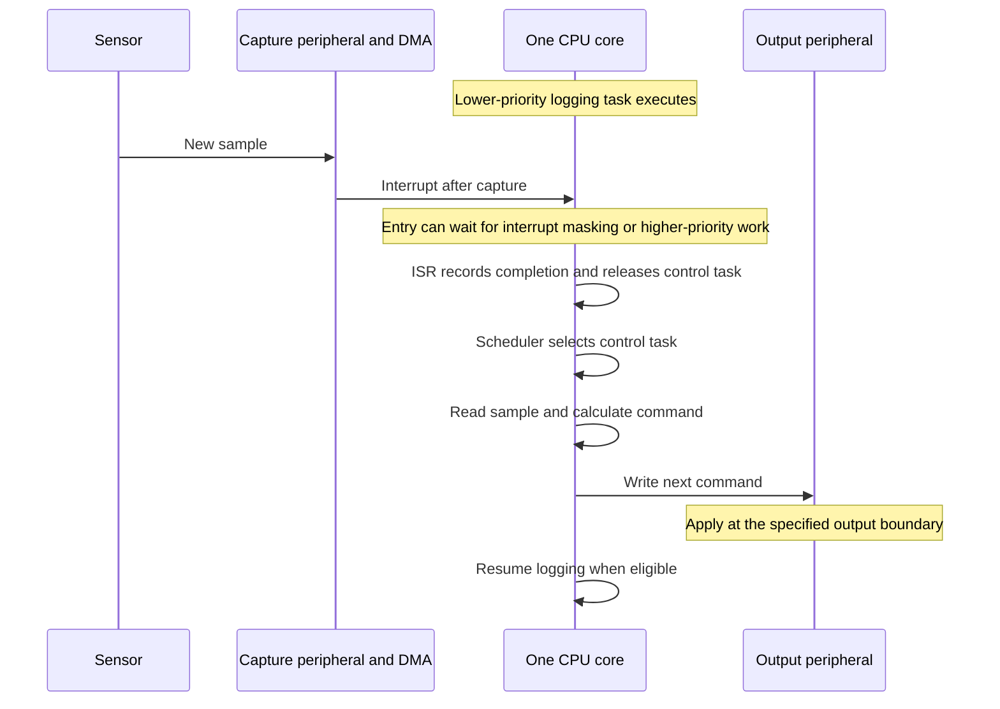
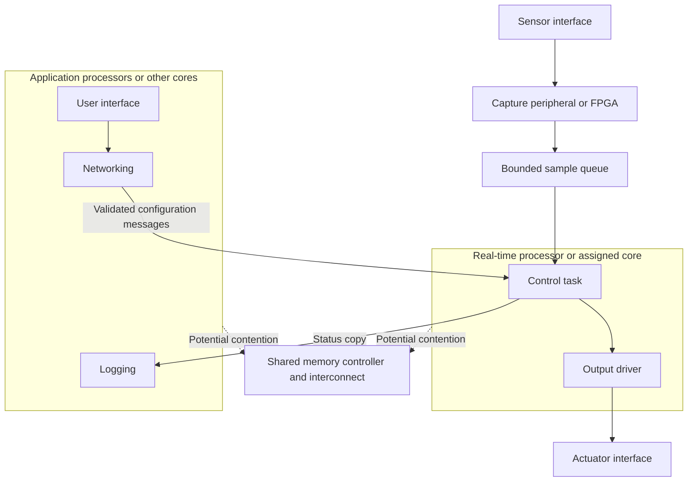
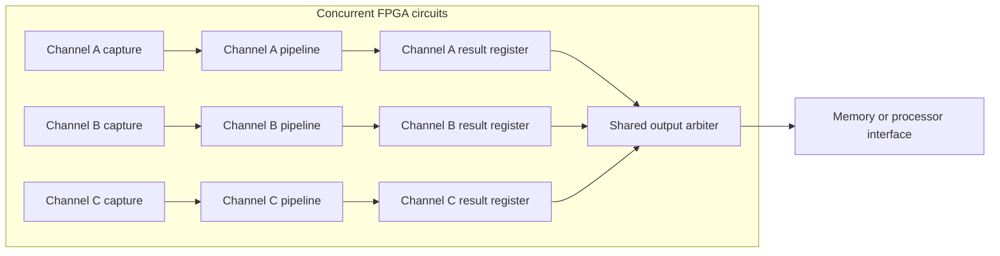
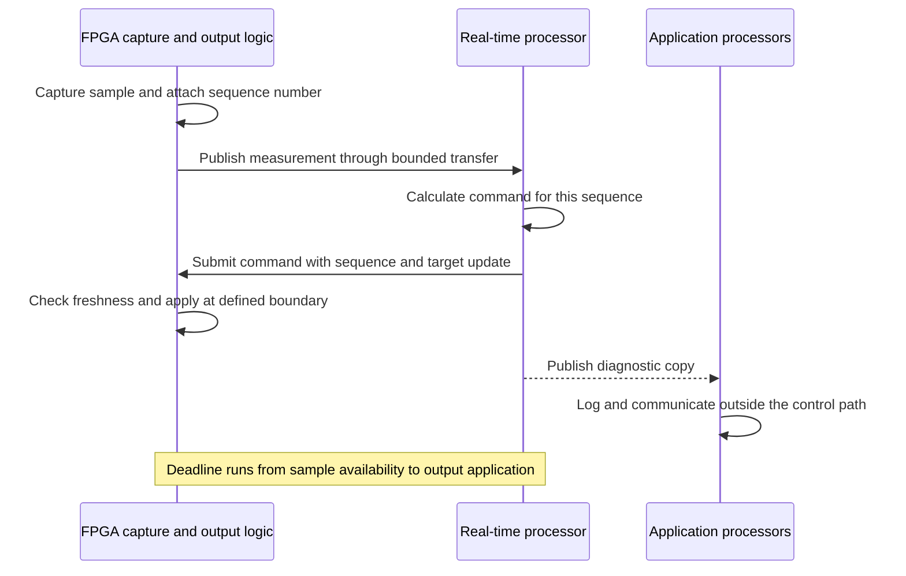
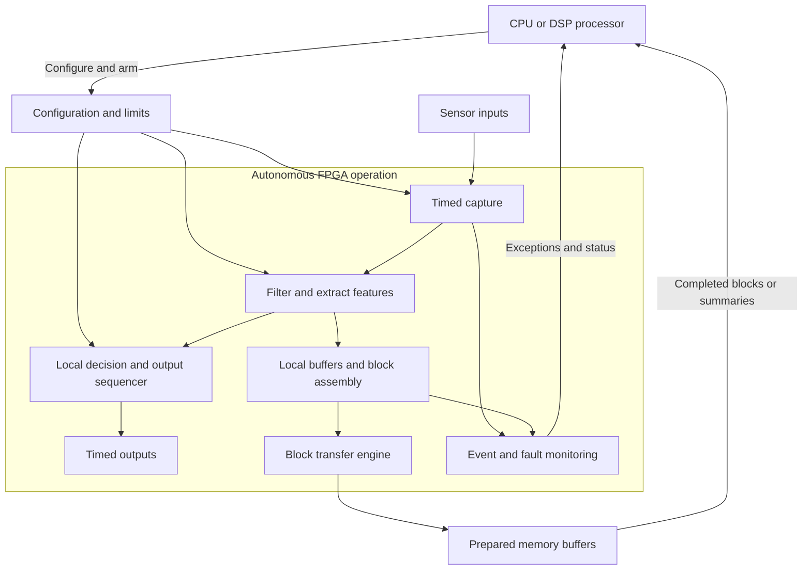
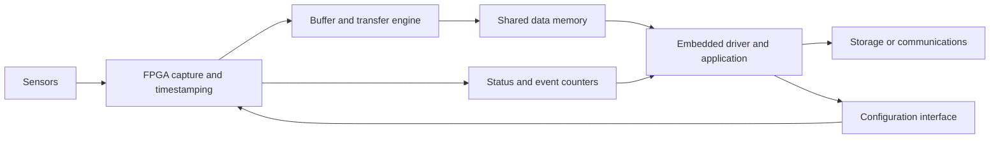
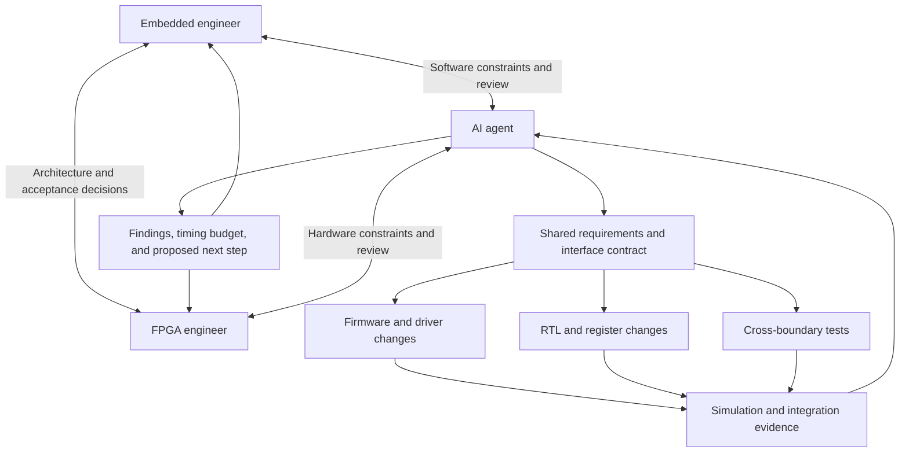

# Embedded and FPGA Engineers: How They Complement One Another

## Building a shared system from software behaviour and hardware timing

An embedded product may need to sample sensors at precise intervals, process several streams at once, communicate with other equipment, and remain understandable when something fails. Meeting these requirements often calls for both processor software and dedicated digital logic. The quality of the product depends on how well those parts work together.

Embedded software engineers bring experience in firmware, drivers, scheduling, communications, diagnostics, and product behaviour. FPGA engineers bring experience in concurrent datapaths, cycle-level timing, digital interfaces, clock domains, and implementation within device limits. Both work with state machines, protocols, memory, and real-time requirements, but examine them through different execution models.

These roles overlap, and one engineer may practise both. Their complementary value comes from bringing both perspectives into architecture, interface design, verification, and debugging.

## 1. Start with the execution model

An embedded engineer considers how instructions execute on a processor, how interrupts and tasks interact, and how peripherals and memory affect response time. A processor can provide tightly controlled timing when the architecture and software are designed for it. The engineer must establish the relevant execution bounds and account for competing work.

An FPGA engineer describes circuits that can operate concurrently. Separate acquisition channels, counters, and processing stages can advance on the same clock edge. That concurrency consumes physical resources, and the logic between registers must meet the clock's timing requirements. External interfaces, memory arbitration, and backpressure can still introduce variable latency.

This distinction changes how each engineer approaches a requirement. For a periodic sampling task, the embedded engineer may propose a timer-triggered peripheral with DMA. The FPGA engineer may propose autonomous sampling logic and a local buffer. Both are valid candidates; the team compares timing, interfaces, processor load, power, cost, and development effort before choosing.

### Real-time behaviour: define the deadline first

In a time-critical system, a result must be correct and arrive within its specified time window. The team should define the triggering event, the observable completion event, the maximum permitted response time, and the permitted variation between responses, or jitter. A hard deadline must be satisfied for every event within the specified operating conditions. Average execution time alone cannot establish that requirement.

For example, a position-control system might require a new actuator command within 50 microseconds of a sensor sample becoming available. That deadline includes input capture, data movement, computation, and output application. Completing the control calculation in 10 microseconds is insufficient if the sample waits 60 microseconds in a queue first. All numerical timings below are illustrative design assumptions, not processor or FPGA benchmarks.

### One CPU core: tasks share instruction execution time

On a single core, application tasks share execution time. A high-priority control task can pre-empt a lower-priority logging task, subject to the system's interrupt, scheduling, and locking rules. Interrupt masking, higher-priority work, memory stalls, and resource ownership can delay the response. FreeRTOS documents this relationship between ready tasks and priority in its [scheduling guide](https://github.freertos.org/Documentation/02-Kernel/02-Kernel-features/01-Tasks-and-co-routines/04-Task-scheduling).

The capture peripheral and DMA can operate while the core executes instructions. Embedded systems therefore already contain hardware concurrency. The timing question is which work uses dedicated hardware, which work needs CPU execution, and what can delay either path.

### Multiple processors or cores: parallel work with shared dependencies

Multiple cores can execute different instruction streams simultaneously. Multiple processor devices can do the same across a board or network. A multicore chip may share caches, memory controllers, and peripherals; separate processors may communicate through shared memory or explicit links. In both arrangements, the cost and timing of communication belong in the execution model.

Two common software arrangements are:

| Arrangement | Execution model | Real-time design concern |
|---|---|---|
| Symmetric multiprocessing, or SMP | One operating-system instance schedules tasks across eligible cores | Task affinity, migration, locks, interrupts, and shared-resource interference |
| Asymmetric multiprocessing, or AMP | Separate software instances run on assigned cores or processors, potentially using different operating systems | Explicit messages, ownership, startup order, and recovery across instances |

For a mixed-criticality instrument, one possible AMP arrangement assigns acquisition control to a real-time processor and networking and presentation to application processors. A similar division can use task and interrupt affinity under SMP, with different isolation and coordination requirements.

An assigned core can reduce scheduling competition without eliminating interference from other cores. A logging task that streams to external memory may still delay the real-time core's memory accesses. A mutex held by another core may block progress, and a full message queue may prevent a producer from publishing a result. The Linux kernel's [real-time hardware guidance](https://www.kernel.org/doc/html/next/core-api/real-time/hardware.html) discusses shared caches, memory, and related sources of interference.

The embedded engineer can minimise work on the critical core, control interrupt placement, and choose bounded communication mechanisms. The FPGA engineer can provide local capture buffers and hardware timestamps so input timing does not depend on when software receives the notification. Both must examine the actual shared dependencies under the specified competing load.

### FPGA execution: stages and channels advance concurrently

An FPGA can implement capture, arithmetic, event detection, and output sequencing as separate circuits. A pipeline can process different samples in different stages during the same clock period. Each stage still has a finite amount of hardware and must meet timing.

Suppose a four-stage datapath has a 100 MHz clock, accepts one sample per cycle, and never stalls. A sample accepted at edge 0 produces its output at edge 4, giving 40 nanoseconds of pipeline latency. Subsequent samples can emerge 10 nanoseconds apart. The table shows the operation performed during each interval between rising edges; each result is registered at the end of its interval.

| Clock interval | Stage 1: validate | Stage 2: scale | Stage 3: compare | Stage 4: form output |
|---|---|---|---|---|
| Edge 0 to 1 | Sample A | — | — | — |
| Edge 1 to 2 | Sample B | Sample A | — | — |
| Edge 2 to 3 | Sample C | Sample B | Sample A | — |
| Edge 3 to 4 | Sample D | Sample C | Sample B | Sample A |
| Edge 4 to 5 | Sample E | Sample D | Sample C | Sample B |

Latency and throughput describe different properties. A four-cycle pipeline does not necessarily accept a new sample every cycle: shared arithmetic, data dependencies, or memory ports may increase its initiation interval. AMD's [pipelining explanation](https://docs.amd.com/r/2022.1-English/ug1399-vitis-hls/Pipelining-Paradigm) distinguishes these quantities.

Multiple channels can also use separate pipelines:

Here, each channel processes data concurrently, but the shared output arbiter can introduce waiting. Its service capacity and arbitration policy determine whether results reach memory within their deadlines. Replicating pipelines does not remove a downstream bottleneck. Conversely, sharing one arithmetic unit between channels can save resources when its schedule still satisfies every channel's requirement.

### Example: a control loop across FPGA and multiple processors

For the 50-microsecond position-control requirement, the FPGA might capture the encoder, timestamp the measurement, and apply output updates at defined boundaries. A real-time processor calculates the next command. Application processors handle network traffic, configuration, and diagnostic presentation.

An initial timing budget might be:

| Contribution | Assumed upper-bound allocation |
|---|---:|
| Capture, alignment, and input conditioning | 4 microseconds |
| Transfer, notification, and dispatch to the real-time processor | 3 microseconds |
| Control calculation, including allowed pre-emption and memory interference | 12 microseconds |
| Command transfer and acceptance | 3 microseconds |
| Wait for the permitted output-update boundary | 2 microseconds |
| Engineering allowance for identified variation | 6 microseconds |
| Total planned budget | 30 microseconds |

This leaves 20 microseconds against the example deadline. Each allocation needs evidence for the actual platform and operating conditions; an allowance cannot replace an unbounded delay. In particular, a periodic output boundary may introduce up to almost one whole update period of waiting unless acquisition and computation are scheduled to meet it. The two-microsecond allocation assumes that relationship has been established.

The FPGA interface can reject stale commands and report missed updates. The required response to a missing command must be defined by the system requirements. Application traffic should not be a prerequisite for completing the loop, although its interference through shared resources must still be included in the budget.

### Further examples of the execution models working together

**Several encoder edges arrive while processors are busy.** FPGA counters or suitable timer capture peripherals record edges and timestamps as they arrive. Multiple CPU cores can later calculate position, velocity, and diagnostics concurrently. Assigning an interrupt handler to another core only helps if the input interface preserves the events until serviced. The engineers agree on maximum edge rate, capture capacity, timestamp resolution, and overflow reporting.

**Several outputs must change together.** Separate software writes, even from different cores, do not by themselves guarantee simultaneous pin transitions. The FPGA can hold pending values and transfer them to output registers on one defined clock edge. A microcontroller's synchronized timer peripherals may provide equivalent functionality for the required channels. The embedded engineer prepares the update; the FPGA or peripheral enforces its timing. Physical output skew and external driver delays remain part of the requirement.

**A high-rate inspection stream feeds a slower decision process.** Parallel FPGA stages can perform pixel operations and extract features while processors classify objects, manage recipes, or report results. If a reject command must reach an actuator before an object arrives, the deadline spans acquisition, frame or region buffering, processing, messaging, and actuator timing. More CPU cores can improve throughput, but a full-frame wait or shared output queue may still dominate the response. The team measures both sustained processing capacity and the worst permitted decision latency.

Across these examples, the complementary work is concrete: the embedded engineer bounds software execution and coordination, while the FPGA engineer bounds circuit and interface behaviour. Together, they account for every handoff from the physical input to the required output event.

## 2. Choose the hardware and software split together

The split should follow measured requirements and implementation costs. A useful starting point is:

| System responsibility | Embedded software contribution | FPGA contribution |
|---|---|---|
| Acquisition | Configure channels, calibration, and operating modes | Capture inputs and enforce required sample timing |
| Processing | Implement adaptable algorithms and reference models | Implement selected parallel or pipelined datapaths |
| Data movement | Manage buffers, descriptors, and consumers | Stream records and execute supported transfers |
| Communications | Manage sessions, commands, and recovery policies | Handle selected interfaces, framing, or timestamping |
| Diagnostics | Interpret faults and present system history | Capture events, counters, and timing evidence |
| Recovery | Coordinate restart and restore configuration | Provide defined reset and fault-containment behaviour |

These are candidate responsibilities, not fixed job boundaries. A microcontroller peripheral may already satisfy an acquisition requirement. An FPGA accelerator may offer little system benefit if copying data into and out of it dominates execution time. A frequently changing algorithm may be easier to maintain in software even when hardware acceleration is possible.

The embedded engineer helps quantify scheduling, driver, and integration costs. The FPGA engineer helps quantify logic, memory, DSP, clocking, and routing costs. Together, they evaluate the complete path from input to useful output.

### Use FPGA independence to reduce CPU and DSP load

An FPGA can run a configured acquisition or processing path without a processor scheduling each operation. Once software supplies parameters, buffers, and operating limits, dedicated logic can capture inputs, process samples, sequence outputs, and report results autonomously. Here, DSP means a programmable digital signal processor; an FPGA may use its own dedicated DSP arithmetic blocks to implement the processing.

The architectural advantage is greatest when the FPGA owns a complete repetitive path. Moving arithmetic into hardware while requiring software to submit every sample and retrieve every result can leave substantial interrupt, copying, and scheduling overhead. A streaming design can remove those interactions from normal operation.

The processor configures the operation, consumes useful results, and handles changes or exceptions. The FPGA performs the repeated work at the input rate. Three examples show how this division can reduce load.

**Filter before sending data to the DSP.** Suppose eight channels each produce 100,000 samples per second. An FPGA can apply a specified anti-alias filter and decimate each channel by ten before transferring data for a slower analysis task. The DSP then receives 80,000 samples per second instead of 800,000. If the record size remains eight bytes, the sample-record traffic falls from 6.4 MB/s to 0.64 MB/s, excluding transfer overhead. The filter must meet the signal-bandwidth and alias-rejection requirements; simply discarding nine samples out of ten is insufficient. If raw data is needed for diagnosis, the FPGA can retain a bounded pre-trigger window and capture a defined event interval separately.

**Transfer complete blocks instead of interrupting for each sample.** For the same aggregate input rate, blocks of 1,024 records produce about 781 block completions per second, compared with 800,000 per-sample notifications. The FPGA can assemble records and drive a supported DMA engine through a prepared descriptor ring. Software replenishes buffers and processes completions in batches. At a steady input rate, filling one block takes 1.28 milliseconds, so this arrangement suits a data-delivery path whose latency budget permits that wait. A tighter control path can operate locally in the FPGA or use a separate, smaller transfer. Partial-block handling, ring exhaustion, and overflow behaviour remain explicit requirements.

**Run repetitive output timing locally.** A CPU or DSP can load a waveform, pulse schedule, or bounded control configuration once. FPGA counters, state machines, and arithmetic then generate successive outputs without a software interrupt for every transition. Software can update the next configuration while the current one executes, with an agreed commit boundary. For a feedback function implemented locally, the sensor-to-output path can continue without a processor round trip. The engineer must still verify the control algorithm, numerical precision, latency, and required response to stale configuration or invalid inputs.

Independence has a defined scope. The path still needs its clocks, power, reset state, and any required memory or interconnect services. If the processor must replenish descriptors continuously, or if a processor reset also resets the acquisition logic, operation remains dependent on it. Local buffering only tolerates a finite interruption. The engineers should specify how long the FPGA can continue without service, what it does when capacity is exhausted, and how software reconnects to the running state.

The resulting CPU or DSP capacity can support higher-level estimation, adaptive algorithms, communications, and diagnostics. Validate the benefit by comparing processor execution time, interrupt rate, memory traffic, and deadline behaviour under the same input and competing load. Include FPGA resource use and system power in that comparison: reduced processor work alone does not establish the total system cost.

## 3. A shared example: continuous data acquisition

Consider an instrument with eight channels, each producing 100,000 samples per second. Suppose the agreed record format uses eight bytes per channel sample, including sample data and metadata. The resulting stream is:

`8 channels × 100,000 samples/s × 8 bytes = 6,400,000 bytes/s`

If the host can stop consuming data for 100 milliseconds, the system needs at least 640,000 bytes of available buffering for that interval. This calculation excludes additional framing, alignment, and operating margin. Sustained downstream bandwidth must also be sufficient to drain accumulated data after the stall.

The FPGA engineer can design capture, timestamping, record assembly, and buffering around the required input timing. The embedded engineer can design DMA handling, storage or network delivery, and recovery from delayed consumers. Both must agree where the buffer resides, who owns it, and what happens when it fills.

The diagram describes functional responsibilities; the actual memory and interconnect arrangement depends on the platform. The design must identify which clocks, power supplies, resets, and memory services acquisition needs. Continued operation during a processor restart is possible only if those dependencies remain available.

## 4. Treat the interface as a shared design

A register map becomes useful when it describes behaviour as well as addresses. Both engineers need to know when a command takes effect, how completion is reported, which accesses have side effects, and what happens if software repeats a request.

Consider updating a sampling configuration containing a channel mask, period, and trigger threshold. If each write immediately changes active hardware, acquisition may briefly use a mixture of old and new values. A shared solution is to write a pending configuration and issue an explicit commit. The FPGA applies the complete configuration at a defined boundary, then reports the applied version. Software can associate subsequent records with that version.

Other interface decisions deserve the same precision:

- Does reading status clear an event, or must software acknowledge it separately?
- How are simultaneous event arrival and acknowledgement handled?
- Can software obtain a consistent snapshot of a counter wider than the register bus?
- Does a completion flag mean a command was accepted, processing finished, or data became visible in memory?
- Which registers and buffers survive each reset?

The embedded engineer can expose awkward access sequences before the RTL becomes established. The FPGA engineer can identify requests that require extra arbitration, storage, or clock-domain handling. An interface specification, reviewed by both, prevents assumptions from becoming incompatible implementations.

## 5. Small changes can improve the whole system

### Batch notifications without losing visibility

Generating an interrupt for every sample in the example would create 800,000 interrupt events per second. The embedded engineer may propose notification after a block of records, reducing interrupt handling overhead. The FPGA engineer can provide a completion queue or record count so software can discover all available work.

The team must also bound notification latency. A block threshold alone may leave a partial block waiting indefinitely when sampling stops. A timeout, explicit flush, or end-of-acquisition notification can address that case. Buffer sizing and interrupt acknowledgement rules complete the design.

### Align pipeline timing with software-visible metadata

The FPGA engineer may add a pipeline stage to meet timing. Samples, timestamps, channel identifiers, and validity flags must remain aligned through that change. If software expects a response within a fixed interval or associates a command with a particular sample boundary, the revised latency must also be reflected in the interface contract.

The embedded engineer helps distinguish latency that affects the product from latency that is hidden by buffering. This gives the FPGA engineer room to improve implementation while preserving the required behaviour.

### Agree on numerical meaning

A 16-bit field does not fully specify a measurement. Both engineers need its signedness, units, scaling, rounding, saturation, and invalid-value representation. An embedded engineer can build a readable reference calculation, while the FPGA engineer implements an appropriate fixed-point datapath.

They then compare results at zero, full scale, negative limits where applicable, rounding boundaries, and overflow conditions. This avoids a design that transfers every bit correctly while interpreting the measurement incorrectly.

## 6. Make data ownership explicit

When FPGA logic and software share memory, the design needs an ownership protocol. A buffer may move from available, to owned by the transfer engine, to complete, to owned by the software consumer, and finally back to available. Software must not recycle it while hardware can still write to it.

The embedded engineer handles the platform's DMA allocation, mapping, cache-coherency, and ordering requirements. The FPGA engineer ensures that transfer completion and descriptor handling obey the agreed protocol. Coherent memory does not remove the need for ownership rules or required memory ordering. The Linux kernel's [DMA mapping guide](https://docs.kernel.org/core-api/dma-api-howto.html) explains these distinctions for Linux drivers; other environments require their platform's equivalent mechanisms.

Clock domains introduce another boundary. A software register write received on a bus clock may need to reach acquisition logic running on a separate clock. The FPGA engineer provides an appropriate transfer mechanism, and software waits for the documented acknowledgement when required. Independent synchronizers on every bit of a changing configuration word do not ensure a consistent word is captured. AMD's [clock-domain crossing guidance](https://docs.amd.com/r/en-US/ug574-ultrascale-clb/Asynchronous-Clock-Domain-Crossing) discusses synchronization and asynchronous FIFOs for these transfers.

## 7. Verify the behaviour across the boundary

RTL simulation and firmware tests answer different questions. Simulation can examine cycle-level protocol behaviour, overflow handling, and reset sequences. Software tests can examine driver state, configuration, error reporting, and application recovery. Integration tests establish whether those implementations agree on the real platform.

For the acquisition instrument, both engineers can define a shared set of scenarios:

- Stop the software consumer and check the specified buffering and overflow policy.
- Change configuration during acquisition and identify the exact record where it takes effect.
- Delay interrupt servicing and check that completed blocks remain discoverable.
- Restart the processor and verify the promised acquisition and recovery behaviour.
- Inject invalid input and confirm that software receives the correct data-quality indication.
- Exercise buffer wraparound and check sequence numbers for missing, duplicated, or reordered records.

Each scenario needs an expected result and observable evidence. A test that merely checks that the application remains running may miss silent data loss. Sequence numbers, configuration versions, timestamps, overflow counters, and captured fault events help both engineers assess the same behaviour.

## 8. Debug with a shared timeline

When a record is missing, the cause may lie in capture, buffering, a transfer descriptor, interrupt handling, or the application consumer. Both engineers benefit from correlating hardware events with software activity.

The FPGA engineer can expose queue occupancy, accepted and dropped record counts, transfer progress, and internal logic-analyser traces. The embedded engineer can capture driver transitions, descriptor ownership, task delays, and application logs. Shared record identifiers or a defined relationship between hardware and software timestamps connect those observations.

For example, if the capture count advances while the completed-transfer count stops, the investigation can focus on buffering and transfers. If transfers complete but the application's sequence count stalls, driver and consumer behaviour become the next areas to examine. These observations narrow the investigation; they still need confirmation against the counter definitions and reset history.

Observability is most useful when designed early. The team should specify what each counter measures, whether it saturates or wraps, and how a consistent snapshot is obtained.

## 9. Learn enough of the other discipline to improve decisions

An embedded engineer benefits from understanding pipelines, finite memory ports, fixed-point arithmetic, clock-domain crossings, and timing closure. These concepts explain why a small interface change can have a significant hardware cost.

An FPGA engineer benefits from understanding interrupt latency, DMA APIs, caches, concurrency, driver lifecycle, and update recovery. These concepts explain why a register interface that works in a testbench may be difficult to use reliably in a running product.

The shared workflow can remain practical: agree on requirements, sketch the partition, define interfaces and failure behaviour, build a minimal path through the system, and measure it. Revisit the partition when evidence shows that a different allocation would improve the product.

## 10. Use an AI agent to connect the two disciplines

An AI agent can help the embedded and FPGA engineers work from the same requirements, interfaces, and evidence. With access to the relevant source files, specifications, and supported tools, it can trace a change across RTL, firmware, tests, and documentation. This is particularly useful where each implementation is locally reasonable but the assumptions at their boundary differ.

The engineers provide complementary judgments. The embedded engineer assesses software execution, integration, and recovery. The FPGA engineer assesses hardware structure, clocking, and implementation. The agent can organise their decisions, prepare coordinated changes, and investigate results within the agreed scope. Unresolved requirements and architectural trade-offs remain explicit decisions for the engineers.

### Turn different concerns into one interface contract

Suppose the FPGA engineer proposes an interrupt when a data block is complete. The embedded engineer needs to know whether several blocks can complete before the interrupt is serviced, how software discovers all of them, and whether acknowledgement can erase a newly arriving event. The agent can collect these questions and draft a contract covering completion counters, descriptor ownership, interrupt assertion and clearing, queue capacity, and reset behaviour.

From an agreed machine-readable register description, the agent can help generate matching RTL constants, firmware headers, and documentation. It can also compare existing implementations against that description and flag inconsistent offsets, field widths, access rules, or reset values. Generated files still need review, and the source of truth must be clear so that later edits do not silently diverge.

### Make an offloading proposal concrete for both engineers

Consider the earlier proposal to replace per-sample notifications with 1,024-record blocks. The agent can calculate the expected completion rate and the 1.28-millisecond block-fill time, then compare that delay with each consumer's requirement. This exposes a useful distinction: the logging path may accept block delivery while the 50-microsecond control path requires a separate mechanism.

The agent can prepare a coordinated change covering FPGA block assembly, DMA configuration, firmware completion handling, and partial-block delivery. The FPGA engineer reviews buffering, transfer capacity, and implementation results. The embedded engineer reviews ownership, cache handling, interrupt behaviour, and processor load. Both review the end-to-end deadline and what happens when software stops servicing the stream.

This gives the team a reviewable proposal with costs and evidence. Useful comparisons include interrupt rate, CPU or DSP execution time, memory traffic, FPGA resource use, delivery latency, and dropped-record counts under the same operating conditions.

### Connect verification on both sides

The agent can express an agreed requirement as related RTL and software checks. For an atomic configuration update, it might prepare a bus-level test that writes pending fields and commits them, a firmware test that waits for the applied version, and an integration check that verifies the version attached to subsequent records. A restart test can check whether software reconnects to the FPGA state promised by the interface contract.

Where tools and hardware are available, the agent can run established simulation, firmware build, and integration commands, then assemble a concise evidence record. It should identify the source revision, FPGA image, firmware version, test conditions, and observed outcome. A test that was prepared but could not be run remains unverified.

Both engineers must also review the checks themselves. If the agent derives the RTL, driver, and tests from the same mistaken interpretation, they may agree with one another while violating the actual requirement. Independent reference calculations, specification review, and physical measurements help address that risk.

### Investigate failures using a shared timeline

For a missing record, the agent can correlate FPGA sequence numbers, DMA completions, interrupt traces, and application logs. It can identify where evidence stops matching the expected flow and propose a focused investigation. A claim that two events occurred in a particular order needs compatible timestamps or shared identifiers; unrelated clock readings cannot establish that order without a known relationship.

For example, if the FPGA reports completed blocks while the driver reports no available descriptors, the agent can compare ownership transitions and acknowledgement rules across both implementations. It can propose a targeted test for the suspected race, prepare a correction, and rerun the relevant checks. The engineers assess whether the evidence supports the diagnosis and whether the change preserves timing and recovery requirements.

The agent's contribution is continuity across the work: a hardware change leads to a review of software assumptions, a software bottleneck leads to a concrete hardware proposal, and an integration failure leads to evidence both engineers can inspect. The [companion article on AI-assisted FPGA development](AI_Agents_and_the_FPGA_Design_Workflow.md) explores the tool-driven implementation and verification loop in more detail.

## A stronger engineering partnership

Embedded and FPGA engineers complement each other through their ability to connect product behaviour with physical implementation. Software expertise helps make hardware configurable, observable, and recoverable. FPGA expertise helps make demanding timing, concurrency, and interface requirements achievable within device limits.

The partnership works best when both engineers share responsibility for the boundaries: configuration, data ownership, timing, reset, and failure recovery. A system succeeds when its software and hardware satisfy the same requirements, supported by evidence that both engineers can understand.

An AI agent can support that partnership by keeping contracts, implementation changes, and verification evidence connected. Its most useful output is a coordinated, reviewable result that helps both engineers make the next system-level decision.
